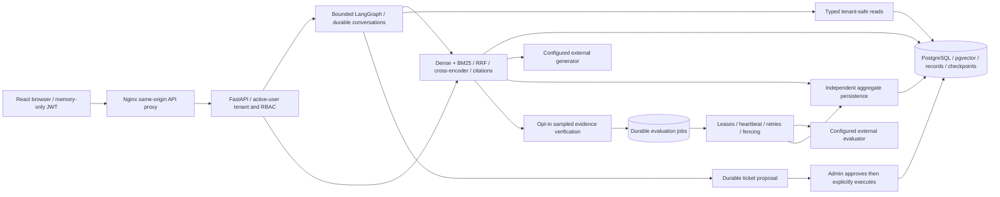
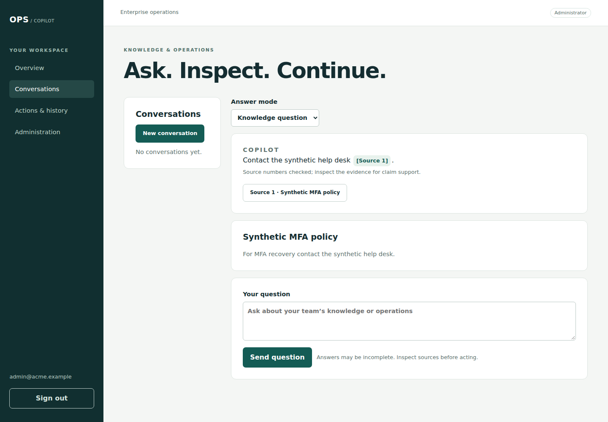
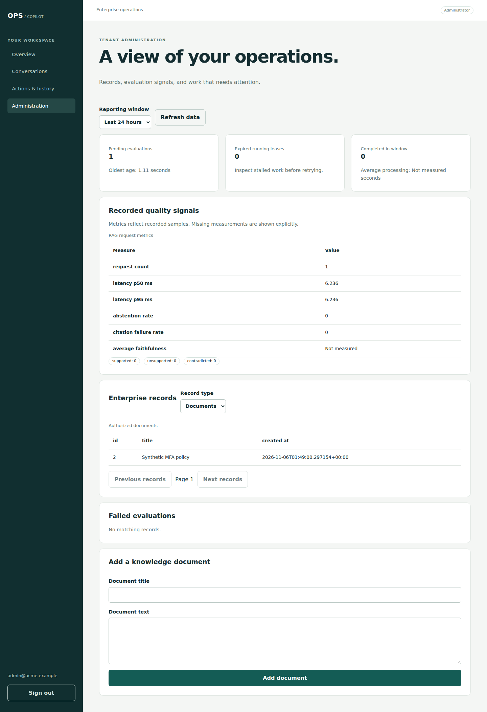

# Enterprise AI Operations Copilot

A multi-tenant support and operations application: retrieve authorized knowledge,
inspect numbered evidence, use bounded enterprise tools, and review proposed
ticket changes before a human applies them. FastAPI, PostgreSQL/pgvector,
LangGraph and a React/TypeScript interface share the existing backend structure.

**Verified locally on Linux ARM64.** Native Compose build/start, migrations,
proxy, DB reconnect and container replacement passed. Browser integration uses
real SQL/auth/graphs/approvals with mocked models. Live Slack verification is
pending at the owner's direction. AWS deployment and hosted CI execution have
not occurred. [Exact status and daily evidence](docs/IMPLEMENTATION_STATUS.md).

## Architecture



[Trust boundaries](docs/ARCHITECTURE.md), [security](docs/SECURITY.md),
[data retention/privacy](docs/EVALUATION_DATA_POLICY.md),
[queue decision](docs/adr/001-postgresql-evaluation-queue.md),
[coordination assessment](docs/adr/002-agent-coordination-assessment.md).

## Implemented behavior and source

| Capability | Main source paths under `backend/` unless noted |
|---|---|
| JWT, active-user checks, invitation-only onboarding, RBAC | `app/auth/` |
| Customer/ticket operations and text knowledge ingestion | `app/api/{customers,tickets,knowledge}.py`, `app/db/models.py` |
| MiniLM 384 embeddings, tenant-filtered pgvector and genuine BM25 | `app/services/{embedding,retrieval,bm25_retrieval}_service.py` |
| Deterministic RRF, cross-encoder and retained PostgreSQL FTS comparison | `app/services/{hybrid_retrieval,reranking,keyword_retrieval}_service.py` |
| RAG generation, citation checks and abstention | `app/services/rag_service.py`, `app/evals/answer_quality.py` |
| Sampled async claim evaluation, independent transactions and safe metrics | `app/services/evaluation_submission.py`, `app/monitoring/`, `app/jobs/`, `app/workers/evaluation_worker.py` |
| Bounded graph, typed read tools and durable owner-scoped checkpoints | `app/services/{agent,tool,conversation}_service.py` |
| Human-approved, atomic ticket status updates and audit events | `app/services/approval_service.py`, `app/api/approvals.py` |
| Default-off tenant-bound Slack history adapter, offline verified | `app/services/connector_service.py`, [setup](docs/CONNECTORS.md) |
| Chat, citations, admin metrics, execution and approval interface | `frontend/src/{Chat,Admin,Activity}.tsx` |
| Privacy-filtered OpenTelemetry / optional collector + Jaeger | `app/monitoring/tracing.py`, `docker-compose.tracing.yml` |

The graph routes explicit read commands (`list tickets`, `show ticket 1`,
`list documents`, `show customer`) and approval proposals (`close ticket 1`,
`update ticket 1 to in_progress`). Other questions use existing RAG. Arbitrary
model-selected writes are not enabled. Multi-agent production routing was not
adopted: the controlled assessment did not demonstrate a policy benefit.
PostgreSQL remains the sole queue; no Redis or Celery is required.

## Repository

```text
backend/
  app/{api,auth,db,evals,jobs,monitoring,services,workers}/
  migrations/versions/       # additive Alembic history
  scripts/                  # migration, safe test DB setup, local demo
  tests/                    # unit, PostgreSQL integration, optional browser journey
  evals/                    # synthetic cases and assessment runners
  Dockerfile, requirements.txt, .env.example
frontend/
  src/                      # React/TypeScript + component tests
  e2e/journey.mjs            # Chromium real-stack synthetic journey
  Dockerfile, nginx.conf, package-lock.json
ops/                        # tracing config and read-only HTTP smoke
.github/workflows/          # offline CI and manual readiness; no AWS deployment
docs/                      # status, architecture, ADRs, operations, journals
```

## Start locally with Docker

From the repository root, copy `.env.example` to `.env` (`cp` on Linux;
`Copy-Item` in PowerShell). Set independent, locally generated URL-safe secrets
for POSTGRES_PASSWORD and JWT_SECRET_KEY. Keep the example's loopback bindings.
Do not commit secrets. No OpenAI key is needed for auth/records/admin operation.

```sh
docker compose -f docker-compose.yml -f docker-compose.deploy.yml config --quiet
docker compose -f docker-compose.yml -f docker-compose.deploy.yml up --build -d
docker compose -f docker-compose.yml -f docker-compose.deploy.yml ps
```

Open <http://127.0.0.1:8080>. Direct API docs: <http://127.0.0.1:8000/docs>.
The one-shot migration service provisions vector before upgrading to Alembic
head. It does not downgrade/delete data. Review and back up existing databases
before upgrading. Fresh native ARM64 setup and volume-preserving restart were
verified; the complete deployment procedure is in [DEPLOYMENT.md](docs/DEPLOYMENT.md).

Create synthetic local records with an explicit command and a password prompt:

```sh
docker compose -f docker-compose.yml -f docker-compose.deploy.yml exec backend python -m scripts.seed_demo --confirm-local-demo
```

Sign in as `admin@demo.example` with the password you chose. The command refuses
to overwrite existing demo records and creates two synthetic tenants and tickets;
it makes no model calls. Upload the synthetic text from
[demo_documents.json](backend/evals/demo_documents.json) through Administration.
Ingestion loads the local embedding model; generation requires a configured
provider key. Model downloads and live inference are not part of the offline demo.
Do not expose the development stack directly to the internet.

Stop with `docker compose -f docker-compose.yml -f docker-compose.deploy.yml down`.
**Keep database volumes.** Never use `down -v` on data you need to retain.

## Develop and test

Use Python3.12 and Node22.12+. `backend/requirements.txt` is UTF-16: pip reads it
as supplied; preserve encoding when editing. Linux backend setup:

```sh
cd backend
python3.12 -m venv .venv
.venv/bin/python -m pip install --upgrade pip==26.2.0
.venv/bin/python -m pip install -r requirements.txt
cp .env.example .env
# Configure the local development DSN/JWT; do not point DATABASE_URL at a test DB.
.venv/bin/python -m scripts.migrate
.venv/bin/python -m uvicorn app.main:app --reload
# Separate terminal, same backend environment:
.venv/bin/python -m app.workers.evaluation_worker
```

PowerShell equivalents: `py -3.12 -m venv .venv`,
`.\.venv\Scripts\Activate.ps1`, `Copy-Item .env.example .env`, then
`python -m pip ...`, `python -m scripts.migrate`, `python -m uvicorn ...`.
For a host-run backend, start only PostgreSQL with `docker compose up -d db`.
Root Compose and `backend/.env` use separate settings files; match their local
DB credentials/port. The host DSN uses localhost; containers use service `db`.

Frontend from root: `npm --prefix frontend ci`, then
`npm --prefix frontend run dev` (loopback 5173, proxy defaults to 8000).
An optional `docker-compose.frontend-dev.yml` provides a container dev workflow.
Never run API/worker tests concurrently against their resetting test fixtures.

From `backend/`, keep DATABASE_URL pointing at the development DB for safety
comparison, provision the two **dedicated disposable** databases, then test:

```sh
.venv/bin/python -m scripts.prepare_test_database
.venv/bin/python -m scripts.prepare_test_database --database copilot_migration_test_db
.venv/bin/python -m pytest tests/ -q -p no:cacheprovider
```

Those fixtures reset only guarded `copilot_test_db`; migration tests independently
reset `copilot_migration_test_db`. Both must be disposable. Browser integration
is opt-in; [VERIFICATION.md](docs/VERIFICATION.md) documents Chromium installation,
Linux/PowerShell commands, mocks and fault coverage. Default runs skip that one
test. CI opts in; hosted execution remains pending a push.

```sh
npm --prefix frontend test -- --reporter=dot
npm --prefix frontend run build
npm --prefix frontend audit --audit-level=low
# Linux; PowerShell use python after activating the backend environment:
backend/.venv/bin/python backend/scripts/check_secrets.py
python3 ops/smoke_http.py http://127.0.0.1:8080
```

## API and controls

| Surface | Contract |
|---|---|
| `GET /health`, `/ready` | Process liveness, DB readiness respectively |
| `POST /auth/login`, `GET /auth/me` | Form credentials → JWT; safe current identity |
| `/auth/invitations/` | Admin invitation and token acceptance; SMTP setup required for delivery |
| `/customers/`, `/tickets/` | Tenant-authorized operational records; platform provisioning is separate |
| `POST /knowledge/documents`, `/knowledge/search` | Admin JSON text upload, authorized search |
| `GET /knowledge/documents/{id}/chunks/{index}` | Tenant-verified source preview |
| `POST /rag/ask` | `{ "question": "What is the MFA policy?", "top_k": 5 }` → answer/sources/abstention/citation flags |
| `POST /agents/run`, `/agents/tools/{name}` | Bounded graph / typed read tool dispatch |
| `/conversations` | Owner-only create/list/detail/messages/resume/delete |
| `/approvals` | Propose/list/detail; separate admin `/{id}/approve`, `/reject`, `/execute` |
| `GET /rag/evaluations/{id}` | Tenant-safe durable job status |
| `GET /rag/monitoring/{summary,jobs,metrics}` | Admin tenant aggregates, paginated jobs and Prometheus text |
| `GET /admin/records/{documents,tickets,users}` | Admin-safe paginated metadata |
| `GET /connectors/slack/history` | Allowlisted tenant-bound read; disabled without local setup |

JWT tenant/user context is server-derived; body-supplied tenant IDs grant no
access. Browser JWTs live only in memory; reload requires login. Approval and
execution are separate explicit choices with server-side reauthorization.
Citation validation checks numbered references, not factual truth. Treat answers
and retrieved content as untrusted and inspect evidence before acting.

Configuration is documented in both `.env.example` files. Evaluation is off by
default (`RAG_EVAL_ENABLED=false`, rate 0). Enabling it can transmit evidence to
an evaluator and incur charges. Empty credentials leave the worker idle without
claiming jobs. BM25 index caching is default-off; enabling it retains bounded
corpus text in process memory. `/metrics` is disabled without a separate operator
token. Tracing is optional and privacy-filtered; full SQL/prompt capture is absent.

## Evidence, demo and limits

**Final local gate:** 214 backend tests passed with Chromium enabled, 17 frontend
tests passed, and production build/TypeScript checks passed. Both dependency
audits reported no known vulnerabilities; the secret scan found no potential
findings. These are dated local results, not hosted CI or security certification.

Latest exact commands/counts are in [IMPLEMENTATION_STATUS.md](docs/IMPLEMENTATION_STATUS.md)
and [VERIFICATION.md](docs/VERIFICATION.md). [PERFORMANCE.md](docs/PERFORMANCE.md)
records repeated local timings: on a 200-chunk synthetic corpus, warm BM25 p50
6.964→4.415ms with identical results; not an end-to-end RAG/model speedup.
Two fixed identifier cases scored Recall@3/MRR 1.0; fixture citations 2/2 and
no-match abstention 1/1. Mocked faithfulness is not evaluator accuracy. Real model
quality, provider token usage/cost and sustained production load remain unmeasured.

[5–8 minute demo](docs/DEMO.md), [operations/troubleshooting](docs/OPERATIONS.md),
[API examples](docs/API_EXAMPLES.md), [changelog](docs/CHANGELOG.md),
[FDE interview preparation](docs/FDE_INTERVIEW.md),
[daily learning journals](docs/learning-journals/),
[AWS preparation — unexecuted](docs/CLOUD_RUNBOOK.md).




Remaining limits: live Slack and AWS pending; no streaming or hard cancellation
of in-flight model calls; small corpora BM25 still loads all authorized chunks;
logical retention is not automated physical erasure; audit events are application
append-only, not tamper-proof against DB administrators; local role/containers
are not a security certification. An upstream NVIDIA ARM64/SBSA wheel metadata
tag makes modern `pip check` fail despite verified Torch import/CPU operations;
see [SECURITY.md](docs/SECURITY.md). No real-model GPU benchmark is claimed.
