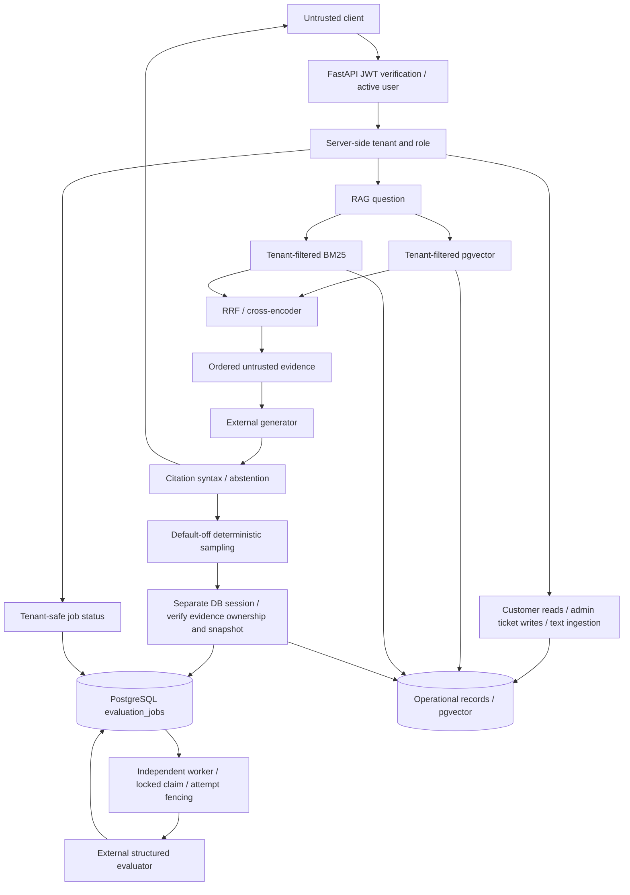
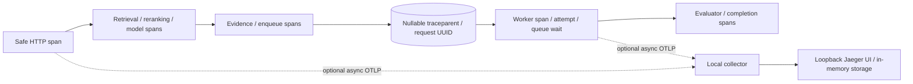

# Architecture and trust boundaries

Verified 2026-11-05; existing package structure is retained.

The sampled enqueue connection is synchronous bounded DB work; evaluator calls
remain in the worker. Queue commit precedes enqueue success. Failure cannot
commit/rollback the request's session. The RAG HTTP response shape is unchanged.

## Trust boundaries

- Client IDs do not establish tenant identity. JWT subject resolves an active
  user; all reads/writes enforce tenant and role at the server.
- Documents, questions and tool-like text are untrusted input, never authority.
  Retrieval filters both document and chunk tenant before fusion/reranking.
- Numbered evidence snapshots preserve generation order. Enqueue rechecks IDs,
  content, title and tenant; it rejects changed or foreign evidence as a unit.
- External model calls receive selected tenant evidence. This transmits content
  to the configured provider; enable evaluation only for approved data handling.
- Logs/metrics contain opaque request IDs, outcome enums and durations, never
  raw prompts/evidence/tokens. Exception messages are excluded from queue logs.
- Evaluation workers use database claims, bounded attempts and stale-attempt
  rejection. Delivery is at-least-once, not exactly-once model execution.
- Test and migration databases are separate allowlisted disposable databases;
  tests must not mutate development or production schemas.
- Future agents/tools/approvals/frontends are roadmap items, absent at audit.

## Day 12 monitoring boundary

`app/api/monitoring.py` uses the existing admin dependency for tenant summaries,
paginated operational rows and tenant Prometheus text. All DB aggregates are
filtered before grouping. Claim verdicts expand only within tenant-scoped SQL;
raw claims never enter the response. `/metrics` is a separate operator surface
disabled without its dedicated secret. It contains global process counters
with fixed outcome labels and no tenant identifiers. Retention is documented
in `EVALUATION_DATA_POLICY.md`; no automatic destructive cleanup is enabled.

## Day 13 tracing boundary

Incoming trace IDs are diagnostic correlation only, never tenant identity or
authorization. Baggage/tracestate are dropped. Manual spans intentionally avoid
automatic SQL parameters and exception text. SDK/exporter versions are pinned.
The optional container stack is configured but runtime verification awaits
Docker daemon permissions; in-memory end-to-end trace tests pass.
