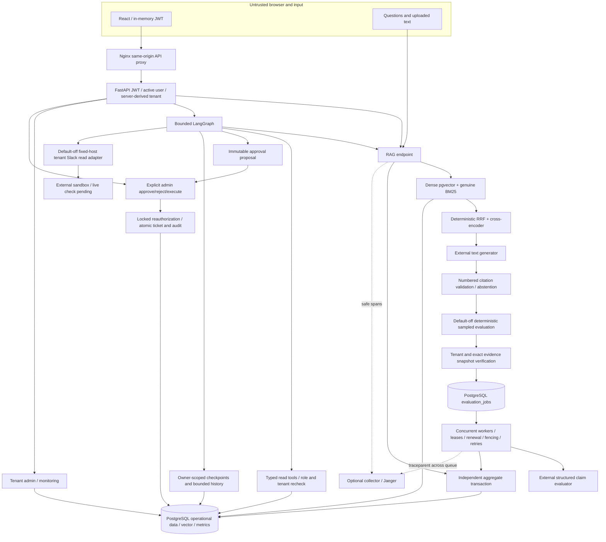

# Verified architecture and trust boundaries

Verified from source and local tests on2026-11-05. Existing backend packages,
FastAPI entrypoint, APIs and applied migrations are preserved.

## Identity and data boundaries

JWT subject resolves an active DB user. Tenant and role come from that verified
record; no model argument or browser-provided tenant ID establishes authority.
Chunk retrieval verifies both document and chunk ownership before fusion.
Read tools have typed bounded arguments, role/active-user checks and independent
sessions. Conversations/checkpoints are owner AND tenant scoped, with run leases
and bounded untrusted history. Checkpointer pending writes persist separately to
handle LangGraph's checkpoint/write ordering; unsafe pickle fallback is disabled.

Questions, retrieved documents, chat history and connector messages remain
untrusted data. Exact command routing, typed tools and server policy prevent
model-generated authority. Graph recursion/cooperative deadlines and provider
timeouts bound work; local model loading cannot be forcibly cancelled safely.
External LangSmith payload capture is explicitly disabled. No production
multi-agent path was enabled after the controlled coordination assessment.

## Durable evaluation and metrics

RAG returns the existing answer contract. Metrics use a separate short-lived
transaction; no raw question/document enters the aggregate table. Unknown
provider usage/cost is null. Recorded core RAG latency excludes aggregate-write
and enqueue overhead, measured separately in PERFORMANCE.md.

Evaluation is opt-in and deterministically sampled by request UUID. Abstentions,
missing/changed/foreign evidence, invalid citations and failed generations do not
enqueue. Exact ordered evidence snapshots are rechecked in an independent DB
session. Enqueue failure is sanitized and cannot commit/rollback request work.
A committed job precedes acknowledgement; evaluator calls never execute inline.

Workers claim with SKIP LOCKED, renew leases independently, fence stale attempts
and bound retries/backoff. Delivery/model calls are at-least-once; only fenced
completion is authoritative. Permanent malformed/auth failures stop early.
No configured provider key means idle/no claims. SIGTERM stops new claims and
drains work. Completion links faithfulness only by matching tenant AND request.
Metric/job read APIs filter tenant before aggregation. Global operator counters
require a separate configured scrape token and have fixed safe labels.

## Human approval boundary

Proposal arguments/expected target state/digest and audit events persist before
any write. Admin approves/rejects explicitly, then explicitly executes. Execution
locks approval and ticket, rechecks active executor/approver, tenant, expiry,
arguments and expected state, and commits ticket/terminal status/event together.
Executed replay does not mutate twice. Events are append-only through the app,
not cryptographically immutable against DB administrators. Persisted conversation
results are JSON-compatible, including proposal timestamps.

## External and browser boundaries

Slack uses tenant-specific tokens/channel allowlists, fixed HTTPS host, no
redirects/arbitrary URLs/proxy inheritance, bounded pagination/timeouts/retries
and local rate limiting. Read-only; no message posts or webhook receiver. Live
sandbox verification is explicitly pending. Secrets belong in an owner-managed
secret store; developer .env is not a production vault.

React holds JWT only in memory, renders content as text and uses same-origin
/api proxy. Source preview independently rechecks tenant. Hiding admin controls
is convenience; backend policy is authoritative. Browser abort stops waiting,
not server execution; inspect persisted state before retrying writes. API body
limits, sanitized errors and security headers complement authorization.

## Deployment and verification boundaries

Compose DB health → single additive vector/Alembic migration → non-root API and
worker → unprivileged Nginx frontend. Native ARM64 startup, fresh schema/indexes,
cache permissions, DB outage/reconnect, backend replacement and volume-preserving
restart passed. Nginx dynamically resolves Docker DNS. No GPU passthrough or
real-model inference claim follows from container health. Optional collector/
Jaeger received a synthetic exported SDK span; local storage is non-durable.

Guarded disposable test DBs are separate from development. Browser integration
uses real SQL/auth/graphs/approvals but mocked model seams. Cloud target, IAM,
TLS and backups are an unexecuted proposal in CLOUD_RUNBOOK.md. No AWS resources,
paid live verification, deployment claims, GitHub protection configuration or
hosted CI success are implied by checked-in configuration.
