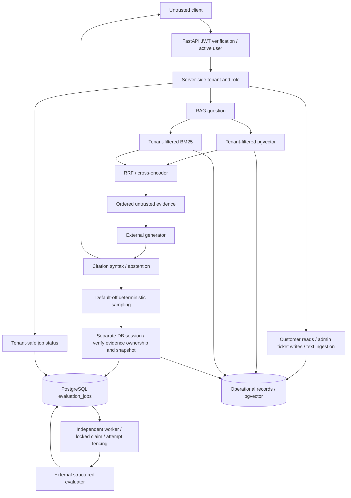
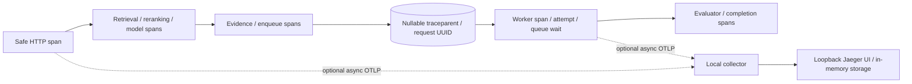

# Architecture and trust boundaries

Verified 2026-11-05; existing package structure is retained.

The sampled enqueue connection is synchronous bounded DB work; evaluator calls
remain in the worker. Queue commit precedes enqueue success. Failure cannot
commit/rollback the request's session. The RAG HTTP response shape is unchanged.

## Trust boundaries

- Client IDs do not establish tenant identity. JWT subject resolves an active
  user; all reads/writes enforce tenant and role at the server.
- Documents, questions and tool-like text are untrusted input, never authority.
  Retrieval filters both document and chunk tenant before fusion/reranking.
- Numbered evidence snapshots preserve generation order. Enqueue rechecks IDs,
  content, title and tenant; it rejects changed or foreign evidence as a unit.
- External model calls receive selected tenant evidence. This transmits content
  to the configured provider; enable evaluation only for approved data handling.
- Logs/metrics contain opaque request IDs, outcome enums and durations, never
  raw prompts/evidence/tokens. Exception messages are excluded from queue logs.
- Evaluation workers use database claims, bounded attempts and stale-attempt
  rejection. Delivery is at-least-once, not exactly-once model execution.
- Test and migration databases are separate allowlisted disposable databases;
  tests must not mutate development or production schemas.
- Future agents/tools/approvals/frontends are roadmap items, absent at audit.

## Day 12 monitoring boundary

`app/api/monitoring.py` uses the existing admin dependency for tenant summaries,
paginated operational rows and tenant Prometheus text. All DB aggregates are
filtered before grouping. Claim verdicts expand only within tenant-scoped SQL;
raw claims never enter the response. `/metrics` is a separate operator surface
disabled without its dedicated secret. It contains global process counters
with fixed outcome labels and no tenant identifiers. Retention is documented
in `EVALUATION_DATA_POLICY.md`; no automatic destructive cleanup is enabled.

## Day 13 tracing boundary

Incoming trace IDs are diagnostic correlation only, never tenant identity or
authorization. Baggage/tracestate are dropped. Manual spans intentionally avoid
automatic SQL parameters and exception text. SDK/exporter versions are pinned.
The optional container stack is configured but runtime verification awaits
Docker daemon permissions; in-memory end-to-end trace tests pass.

Runtime follow-up: collector/Jaeger synthetic trace verification subsequently
passed; the isolated test containers were stopped.

## Day 14 agent

Authenticated user → `app/api/agents.py` → typed LangGraph in
`app/services/agent_service.py` → classify → existing RAG or refuse → end.
Identity is frozen outside model-controlled graph state and rechecked against
the database. Recursion and cooperative elapsed-time budgets bound the graph;
no graph node writes enterprise records. No external LangSmith capture or
checkpointer is enabled. Existing `/rag/ask` contract is preserved.

## Day 15 tools

Auth → typed read-only registry → independent session/user recheck → scoped
Customer/Document/Ticket query → capped metadata/summary. Tool inputs reject
caller tenant fields. Statement timeout is local to its transaction. Logs use
only capability name/outcome/duration. Unknown writes return404; foreign record
IDs are indistinguishable from missing records. Model/content cannot choose
arbitrary code or modify server authorization.

## Day16 worker scaling

One PostgreSQL queue; configurable independent consumers and heartbeat sessions.
Every completion/failure/renewal is fenced by job, attempt, running status and
lease validity. No session crosses thread boundaries. SIGTERM/SIGINT stops new
claims while existing work drains. ADR001 records actual local measurements
and why a second queue is not justified.

## Day17 conversation/checkpoint boundary

Authenticated owner + tenant → conversation API →120s fenced run lease →
LangGraph BaseCheckpointSaver implemented over SQLAlchemy/PostgreSQL →
existing agent graph. Separate checkpoint/pending-write tables accommodate
LangGraph background write ordering. Each transaction locks/validates the
conversation before state access; stale run tokens cannot commit newer state.
No pickle fallback. State can contain private content; no payload tracing.
Logical expiry30days; owner DELETE cascades only idle conversation data.

## Day18 approval boundary

Graph/API proposes immutable ticket arguments → durable approval record →
explicit tenant-admin approve/reject → separate explicit execute → transaction
locks proposal+ticket, rechecks active roles/expiry/digest/expected state and
commits ticket+terminal status+audit event atomically. No generic mutating tool
is exposed. Idempotency key scopes tenant/requester; execution replays return
the existing terminal result. Application append-only events are not a
cryptographic defense against a fully privileged database operator.

## Day20 connector trust boundary

Authenticated tenant → fixed Slack read adapter → tenant-specific bot token +
channel allowlist → first-party HTTPS history endpoint. No arbitrary outbound
URL, redirects, proxy inheritance, message posting or raw-error logging. Standalone
reads are not persisted; conversation tool results can enter owner checkpoints.
Live sandbox scope/account verification remains pending.

## Day21 browser boundary

React/TypeScript → same-origin /api proxy → existing JWT FastAPI. Token held
in memory, no persistent browser storage/cookie credential flow. Browser role
navigation is convenience only; API enforces identity/role/tenant. /auth/me is
additive and omits password hashes. No Sites hosting/account is registered.

## Day22 source boundary

Browser answer/source metadata → separate authorized document/chunk preview read.
Both tenant owners must match current user; source numbers alone grant no access.
React renders content as text and cancels stale previews. Browser abort is not
server/model cancellation; no automatic resubmission or streaming is implemented.

## Day23 administration

Admin React view → existing Day12 aggregates + new tenant-scoped metadata
queries. Server require_admin, bounded pagination and explicit column selection
are the security boundary; hidden links are only convenience. Text ingestion
reuses the existing authorized endpoint and local embedding pipeline.

## Day24 approval UI

Browser explicitly selects proposal → fresh authorized detail → confirmation →
admin approval → new confirmation → separate execution. Client guards reduce
double clicks; backend Day18 transaction/fencing is authoritative. Conversation
steps/results use owner-scoped persisted turns and real turn timestamps.
