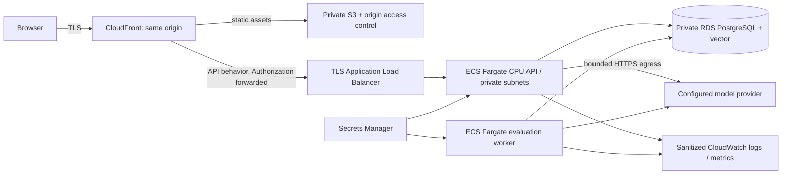

# AWS deployment preparation — NOT DEPLOYED

No AWS resources, IAM grants, remote state, credentials or paid services were
created. This is a bounded staging target proposal and an unexecuted runbook.
Owner approval of region, monthly budget, credentials and data policy is required
before implementing/applying infrastructure. No Terraform skeleton is presented
as deployable infrastructure. The locally verified Compose stack is the current
deployment artifact; AWS-specific networking/runtime configuration remains work.

## Proposed staging target

One API task and one worker initially; bound each task's CPU/memory after real
model measurement. Use reviewed native ARM64 image digests; Fargate supports
ARM64 via runtimePlatform, but this is CPU inference, not DGX GPU passthrough.
Region/AZ capacity and exact RDS engine/vector support must be checked at
provision time. Store provisioned extension/schema under a separate migration
role; runtime role gets only required table/sequence rights. No public DB.

CloudFront must forward Authorization to the API behavior, disable API caching,
and strip `/api` with a reviewed function before forwarding to ALB; static
behavior must not capture authenticated API failures as SPA responses. These
cloud-specific behaviors are not deployed/tested. The local Nginx Docker DNS
configuration is not an ECS service-discovery configuration and must not be
copied blindly. Restrict ALB origin access; use ACM certificates, strict TLS,
HTTPS redirects and secure headers. Restrict API SG ingress to ALB; DB SG to
API/worker/migration tasks. Plan explicit provider/Hugging Face egress or bake
reviewed model artifacts into a release image. No public arbitrary connector URL.

## Approval and budget gates

1. Owner selects account/region, staging lifetime, allowed data and budget cap.
   Price API/worker CPU/memory, RDS storage/backups, ALB, NAT or VPC endpoints,
   logs and transfer using current AWS pricing. No cost estimate is fabricated.
2. Configure budget alerts and owner notification, service/task max counts,
   log retention, provider spend limits and cleanup schedule. Budget alerts do
   not guarantee a hard spending cap; NAT/ALB/DB incur idle costs.
3. Use GitHub OIDC only after approval, scoped to this repository/main and a
   protected staging environment; no long-lived AWS keys in GitHub or repo.
   Separate build/ECR push, migration and deployment IAM responsibilities.
4. Configure `cloud-staging` required reviewers, prevent self-review and limit
   deployment branches to main in GitHub settings. Set environment variable
   `CLOUD_RELEASE_REVIEW_ENABLED=true` only after checking protections. YAML
   cannot create these account settings; their existence is currently unverified.
5. `.github/workflows/release-readiness.yml` is a manual, read-only configuration
   check with that environment gate. It does not deploy and has no OIDC/write
   permission. Real deployment automation must be added after approvals.

## Release, smoke, rollback — unexecuted

- Pass offline CI and local native deployment smoke. Pin/scanner-review image
  digests, record commit and schema head, inspect generated IaC plan for cost,
  public endpoints, deletion and permissions before a human applies it.
- Provision private DB, vector and secret references with TLS-required DB URLs.
  Secrets Manager injection should supply URL-safe credentials or a correctly
  encoded DSN; never echo task definitions containing resolved secrets.
- Snapshot/verify backup restore before schema upgrades. Run exactly one migration
  task to head, then API and worker. Test `/ready`, authentication, tenant-negative
  checks, synthetic upload, citation, proposal/approve/execute, worker completion
  and dashboard. Real model/provider tests require separate spend approval.
- Monitor errors, p95, queue age/retries and provider spend. On regression, pause
  new traffic/worker claims and roll back API/worker image digests only if schema
  compatible. Never automatically downgrade/delete live tables. Restore a backup
  into a separate DB and verify it before any reviewed cutover.
- Teardown staging only with explicit approval; preserve required backups and
  account for snapshots/logs/storage left billable. Do not publish real demo data.

## CI evidence and sources

`ci.yml` runs offline PostgreSQL regression/migrations, secret scanning, Python
advisory audit, frontend tests/build/audit and Compose validation. No paid model
calls or deployment credentials. Actions are pinned to official v7 commit refs
resolved on2026-11-05; update through review. Hosted CI execution is pending push;
local command results are recorded in IMPLEMENTATION_STATUS.md. GitHub hosted
architecture/runtime and package resolution may expose differences from DGX.

Official references checked: [ECS ARM64](https://docs.aws.amazon.com/AmazonECS/latest/developerguide/ecs-arm-specifying.html),
[Fargate task parameters](https://docs.aws.amazon.com/AmazonECS/latest/developerguide/task_definition_parameters.html),
[RDS extension support](https://docs.aws.amazon.com/AmazonRDS/latest/UserGuide/PostgreSQL.Concepts.General.FeatureSupport.Extensions.html),
[GitHub environment protection](https://docs.github.com/en/actions/reference/workflows-and-actions/deployments-and-environments),
[checkout](https://github.com/actions/checkout), [setup-python](https://github.com/actions/setup-python),
[setup-node](https://github.com/actions/setup-node). The proposed design is our
engineering plan, not evidence of deployed infrastructure.
